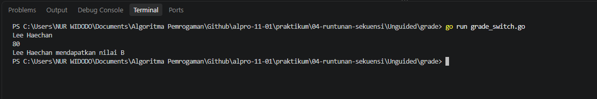
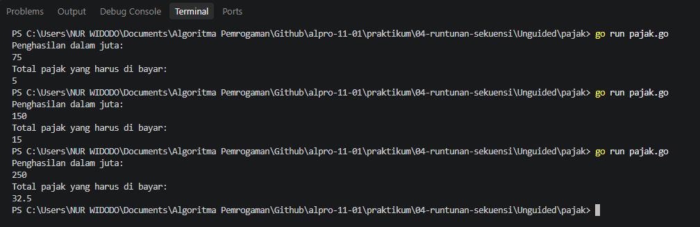

# <h1 align="center">Laporan Praktikum Modul 04 - Runtunan Sekuensi</h1>
<p align="center">Nur Widodo - 109092630005</p>

## Dasar Teori

### A. Pengenalan Runtunan Sekuensi
Runtunan atau sekuensi adalah struktur algoritma yang menjalankan setiap instruksi secara berurutan dari langkah pertama hingga langkah terakhir. Setiap perintah dijalankan satu kali sesuai urutan penulisannya, tanpa menggunakan percabangan atau perulangan.
### B. Penggunaan Case, Switch, dan Default
Dalam bahasa Go, switch digunakan untuk memilih dan memeriksa beberapa kondisi atau nilai, case berisi pilihan kondisi yang akan dijalankan jika sesuai dengan nilai yang diperiksa oleh switch, sedangkan default dijalankan apabila tidak ada case yang sesuai.

## Guided

### 1. grade.go

```go
package main

import (
	"bufio"
	"fmt"
	"os"
)

func main() {
	var nama string
	var nilai float64
	var grade string

	scanner := bufio.NewScanner(os.Stdin)
	scanner.Scan()

	nama = scanner.Text()

	fmt.Scan(&nilai)

	if nilai >= 90 && nilai <= 100 {
		grade = "A"
	} else if nilai >= 80 && nilai < 90 {
		grade = "B"
	} else if nilai >= 70 && nilai < 80 {
		grade = "C"
	} else if nilai >= 60 && nilai < 70 {
		grade = "D"
	} else {
		grade = "F"
	}

	fmt.Printf("%s mendapatkan nilai %s\n", nama, grade)
}

```
#### Output


#### Deskripsi
Program ini berfungsi untuk membaca nama dan nilai siswa, menentukan nilai huruf A sampai F berdasarkan rentang nilai, lalu menampilkan hasilnya.

### 2. penilaian.go

```go
package main

import (
	"bufio"
	"fmt"
	"os"
)

func main() {
	var pilihan int
	var nama string
	var nilai float64
	var grade string

	fmt.Println("============= Menu =============")
	fmt.Println("1. Sistem penilaian")
	fmt.Println("0. Keluar")
	fmt.Print("Pilih opsi: ")

	fmt.Scanln(&pilihan)

	if pilihan == 1 {
		fmt.Print("Masukkan nama siswa: ")

		scanner := bufio.NewScanner(os.Stdin)

		scanner.Scan()

		nama = scanner.Text()

		fmt.Print("Masukkan nilai siswa: ")
		fmt.Scanln(&nilai)

		if nilai >= 90 && nilai <= 100 {
			grade = "A"
		} else if nilai >= 80 && nilai < 90 {
			grade = "B"
		} else if nilai >= 70 && nilai < 80 {
			grade = "C"
		} else if nilai >= 60 && nilai < 70 {
			grade = "D"
		} else {
			grade = "F"
		}

		fmt.Printf("%s mendapatkan nilai %s\n", nama, grade)

	} else if pilihan == 0 {
		fmt.Println("Keluar dari program.")

	} else {
		fmt.Println("Pilihan tidak valid.")
	}
}
```
#### Output


#### Deskripsi
Program ini menampilkan menu sistem penilaian siswa atau keluar dari program. Jika pengguna memilih 1, program membaca nama dan nilai siswa lalu menampilkan nilai hurufnya. Jika memilih 0, program berhenti, sedangkan pilihan lain menampilkan pesan tidak valid.

### 3. klasifikasi.go

```go
package main

import (
	"fmt" // Hanya memerlukan fmt untuk keperluan input dan output
)

func main() {
	// Pendefinisian variabel secara eksplisit beserta tipe datanya
	var usia int
	var gaji int
	var keterangan string

	// Membaca dua masukan berupa angka dari pengguna (usia dan gaji)
	// fmt.Scan otomatis memisahkan input berdasarkan spasi atau baris baru (enter)
	fmt.Scan(&usia)
	fmt.Scan(&gaji)

	// Menggunakan switch tanpa ekspresi.
	// Cara kerjanya sama persis seperti deretan if - else if.
	// Program akan mengecek dari atas ke bawah, dan menjalankan case pertama yang bernilai benar (true).
	switch {
	case usia < 18:
		keterangan = "Masih sekolah"
	case usia >= 18 && usia <= 25 && gaji >= 50:
		keterangan = "Muda sukses"
	case usia >= 18 && usia <= 25 && gaji < 50:
		keterangan = "Masih belajar hidup"
	case usia >= 26 && usia <= 40 && gaji >= 100:
		keterangan = "Pekerja mapan"
	case usia >= 26 && usia <= 40 && gaji < 100:
		keterangan = "Perlu perbaikan karier"
	case usia > 40 && gaji >= 150:
		keterangan = "Profesional berpengalaman"
	case usia > 40 && gaji < 150:
		keterangan = "Perlu evaluasi finansial"
	}

	// Menampilkan hasil klasifikasi ke layar
	fmt.Println(keterangan)
}

```
#### Deskripsi
Program ini membaca usia dan gaji tahunan seseorang, lalu menggunakan switch untuk menentukan klasifikasi berdasarkan rentang usia dan batas gaji. Hasilnya berupa keterangan seperti Muda sukses, Pekerja mapan, atau Perlu evaluasi finansial.

## Unguided

### 1. grade_switch.go

```go
package main

import (
	"bufio"
	"fmt"
	"os"
)

func main() {
	var nama string
	var nilai float64

	scanner := bufio.NewScanner(os.Stdin)
	scanner.Scan()
	nama = scanner.Text()

	fmt.Scan(&nilai)

	var grade string

	switch {
	case nilai >= 90 && nilai <= 100:
		grade = "A"
	case nilai >= 80:
		grade = "B"
	case nilai >= 70:
		grade = "C"
	case nilai >= 60:
		grade = "D"
	default:
		grade = "F"
	}

	fmt.Printf("%s mendapatkan nilai %s\n", nama, grade)
}
```

##### Output


#### Deskripsi
Program ini berfungsi untuk membaca nama dan nilai siswa, menentukan nilai huruf A sampai F berdasarkan rentang nilai, lalu menampilkan hasilnya dengan menggunakan switch.

### 2. pajak.go

```go
package main

import "fmt"

func main() {
	var penghasilan, pajak float64

	fmt.Println("Penghasilan dalam juta: ")
	fmt.Scan(&penghasilan)

	if penghasilan <= 50 {
		pajak = 0.05 * penghasilan
	} else if penghasilan <= 100 {
		pajak = 0.05*50 + 0.10*(penghasilan-50)
	} else if penghasilan <= 200 {
		pajak = 0.05*50 + 0.10*50 + 0.15*(penghasilan-100)
	} else {
		pajak = 0.05*50 + 0.10*50 + 0.15*100 + 0.20*(penghasilan-200)
	}

	fmt.Println("Total pajak yang harus di bayar: ")
	fmt.Println(pajak)
}
```

##### Output


#### Deskripsi
Membuat program yang menghitung total pajak penghasilan seseorang berdasarkan dari total penghasilannya dalam "juta".

## Kesimpulan

Runtunan dan sekuensi merupakan konsep dasar dibahasa Go yang dimana kode dieksekusi berdasarkan urutan dari atas kebawah.

Praktikum ini bertujuan untuk memahami runtutan, sekuensi dan cara koding seperti switch case dan if else.

## Referensi
1. Go Team. (2026). _The Go Programming Language Specification_. Google LLC. Diakses pada 04 Oktober 2026 melalui https://go.dev/ref/spec.
