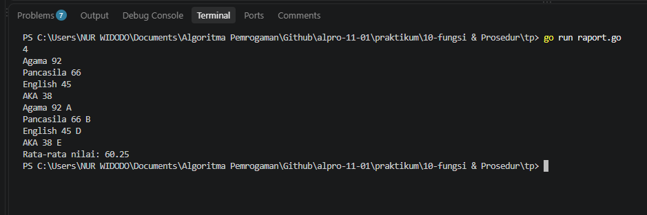
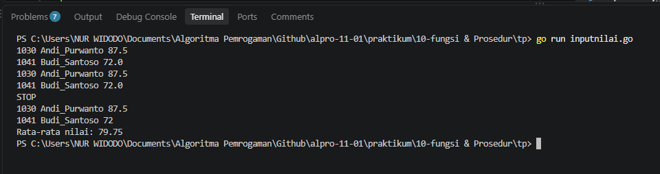

# <h1 align="center">Tugas Pendahuluan Modul 10 - Fungsi & Prosedur</h1>
<p align="center">Nur Widodo - 109092630005</p>

### 1. raport.go

```go
package main

import "fmt"

const NMAX int = 999

type Raport struct {
	matkul string
	skor   int
}
type TabRaport [NMAX]Raport

func konversiHuruf(n int) string {
	if n > 80 && n <= 100 {
		return "A"
	} else if n > 70 && n <= 80 {
		return "AB"
	} else if n > 65 && n <= 70 {
		return "B"
	} else if n > 60 && n <= 65 {
		return "BC"
	} else if n > 50 && n <= 60 {
		return "C"
	} else if n > 40 && n <= 50 {
		return "D"
	}
	return "E"
}

func rataRata(T TabRaport, n int) float64 {
	var total int = 0
	for i := 1; i <= n; i++ {
		total += T[i].skor
	}
	return float64(total) / float64(n)
}

func main() {
	var listNilai TabRaport
	var jumlah int
	fmt.Scan(&jumlah)

	for i := 1; i <= jumlah; i++ {
		fmt.Scan(&listNilai[i].matkul, &listNilai[i].skor)
	}
	for i := 1; i <= jumlah; i++ {
		fmt.Printf("%s %d %s\n", listNilai[i].matkul, listNilai[i].skor, konversiHuruf(listNilai[i].skor))
	}
	fmt.Printf("Rata-rata nilai: %.2f\n", rataRata(listNilai, jumlah))
}

```

#### Desripsi
Program ini menampilkan mata kuliah beserta nilai huruf dan rata-rata nilai keseluruhan melalui nilaiHuruf (mengonversi nilai angka ke huruf), rataRata (menghitung rata-rata nilai seluruh mata kuliah), dan main (mengatur input, pemanggilan fungsi, serta output).

#### Output


### 2. inputnilai.go

```go
package main

import "fmt"

const NMAX int = 100

type Mahasiswa struct {
	nim, nama string
	nilai     float64
}
type TabMhs [NMAX]Mahasiswa

func cariNIM(T TabMhs, n int, targetNIM string) int {
	for i := 0; i < n; i++ {
		if T[i].nim == targetNIM {
			return i
		}
	}
	return -1
}

func rataRata(T TabMhs, n int) float64 {
	if n == 0 {
		return 0
	}
	var total float64 = 0
	for i := 0; i < n; i++ {
		total += T[i].nilai
	}
	return total / float64(n)
}

func main() {
	var dataMhs TabMhs
	var jumlah int = 0
	var id, nama string
	var skor float64

	for {
		fmt.Scan(&id)
		if id == "STOP" {
			break
		}
		fmt.Scan(&nama, &skor)

		if cariNIM(dataMhs, jumlah, id) == -1 && jumlah < NMAX {
			dataMhs[jumlah].nim = id
			dataMhs[jumlah].nama = nama
			dataMhs[jumlah].nilai = skor
			jumlah++
		}
	}

	for i := 0; i < jumlah; i++ {
		fmt.Println(dataMhs[i].nim, dataMhs[i].nama, dataMhs[i].nilai)
	}
	fmt.Printf("Rata-rata nilai: %.2f\n", rataRata(dataMhs, jumlah))
}

```

#### Output



#### Deskripsi
Program ini menginput nilai ujian mahasiswa, menghapus data duplikat, dan menghitung rata-rata nilai bersih melalui cariNIM (mengecek duplikasi NIM), rataRata (menghitung rata-rata data bersih), serta main (mengatur input, pemanggilan fungsi, dan output).

## Kesimpulan
Semua program di atas menggunakan fungsi (func)