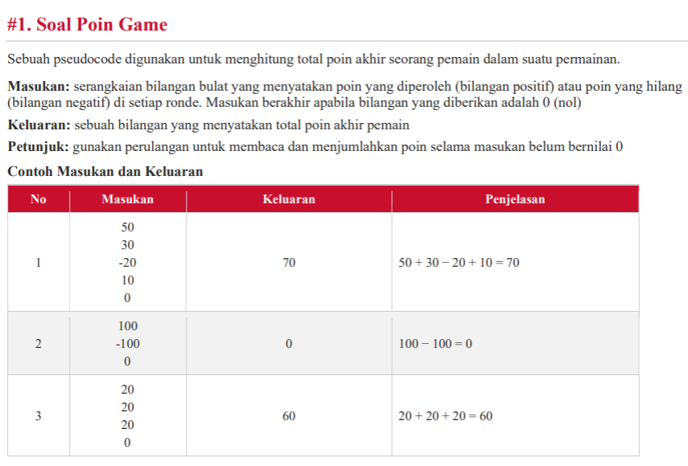
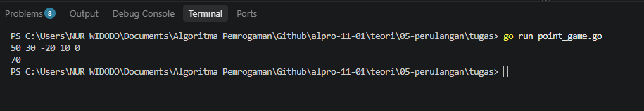
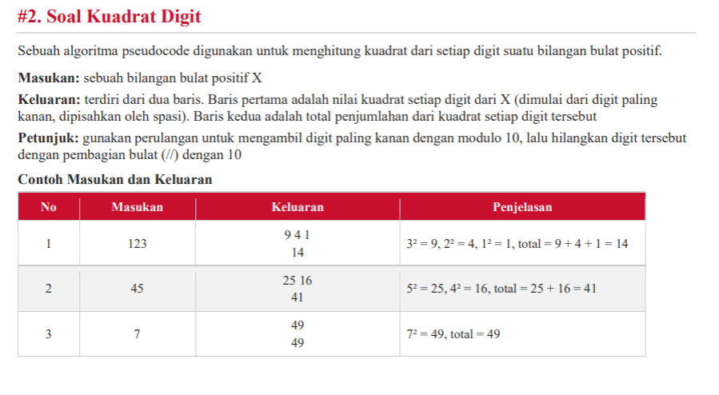
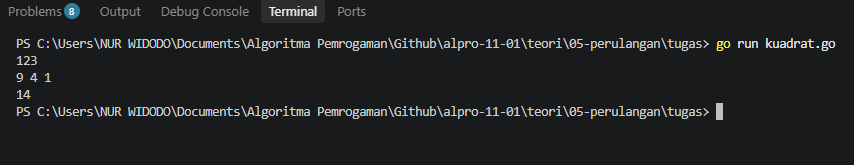
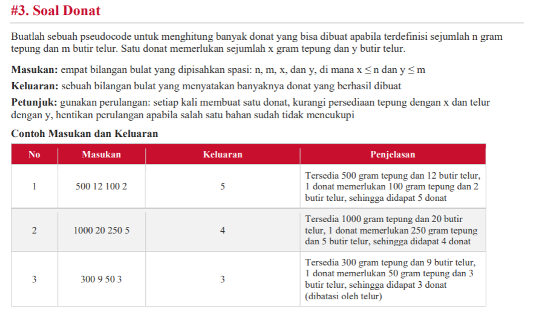
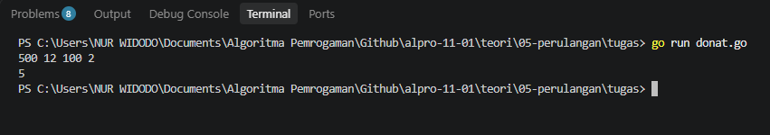
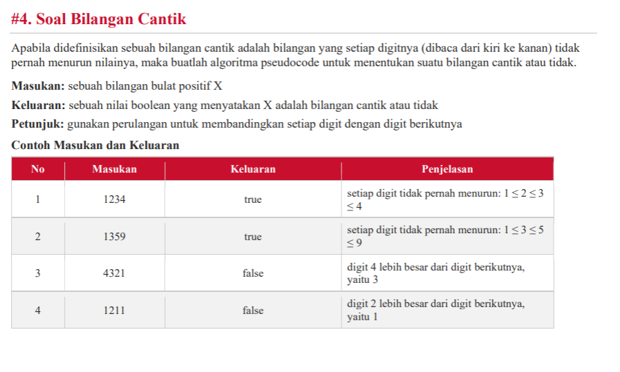
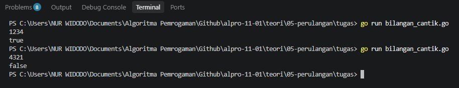
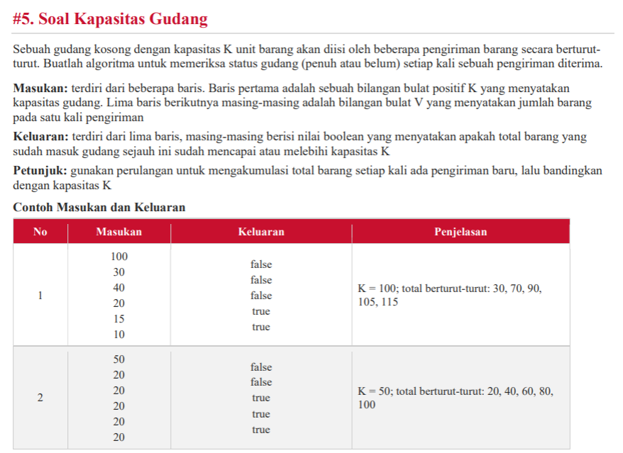
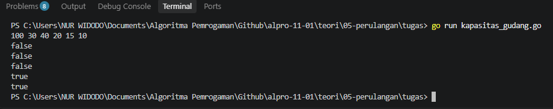

# <h1 align="center">Tugas Mandiri 05</h1>
<p align="center">Nur Widodo - 109092630005</p>

### 1. Soal Poin Game
### Soal:


### Kode Go:
```go
package main

import "fmt"

func main() {
	var poin, total int

	for {
		fmt.Scan(&poin)
		if poin == 0 {
			break
		}
		total += poin
	}

	fmt.Println(total)
}

```

### Output:



### 2. Soal kuadrat Digit
### Soal:


### kode go:

```go
package main

import (
	"fmt"
	"strings"
)

func main() {
	var x int
	fmt.Scan(&x)

	var kuadratList []string
	var total int

	for x > 0 {
		digit := x % 10
		k := digit * digit
		total += k
		kuadratList = append(kuadratList, fmt.Sprintf("%d", k))
		x /= 10
	}

	fmt.Println(strings.Join(kuadratList, " "))
	fmt.Println(total)
}

```
### Output:


### 3. Soal Donat
### Soal:


### Kode Go:
```go
package main

import "fmt"

func main() {
	var n, m, x, y int
	fmt.Scan(&n, &m, &x, &y)

	jumlahDonat := 0

	for n >= x && m >= y {
		n -= x
		m -= y
		jumlahDonat++
	}

	fmt.Println(jumlahDonat)
}

```

### Output:


### 4. Soal Bilangan Cantik
### Soal:


### Kode Go:
```go
package main

import "fmt"

func main() {
	var x int
	fmt.Scan(&x)

	isCantik := true
	prevDigit := 10

	for x > 0 {
		currentDigit := x % 10
		if prevDigit < currentDigit {
			isCantik = false
			break
		}
		prevDigit = currentDigit
		x /= 10
	}

	fmt.Println(isCantik)
}

```

### Output:


### 5. Soal Kapasitas Gudang
### Soal:


### Kode Go:
```go
package main

import "fmt"

func main() {
	var kapasitas, pengiriman int
	fmt.Scan(&kapasitas)

	totalBarang := 0

	for i := 0; i < 5; i++ {
		fmt.Scan(&pengiriman)
		totalBarang += pengiriman

		if totalBarang >= kapasitas {
			fmt.Println(true)
		} else {
			fmt.Println(false)
		}
	}
}

```

### Output:
