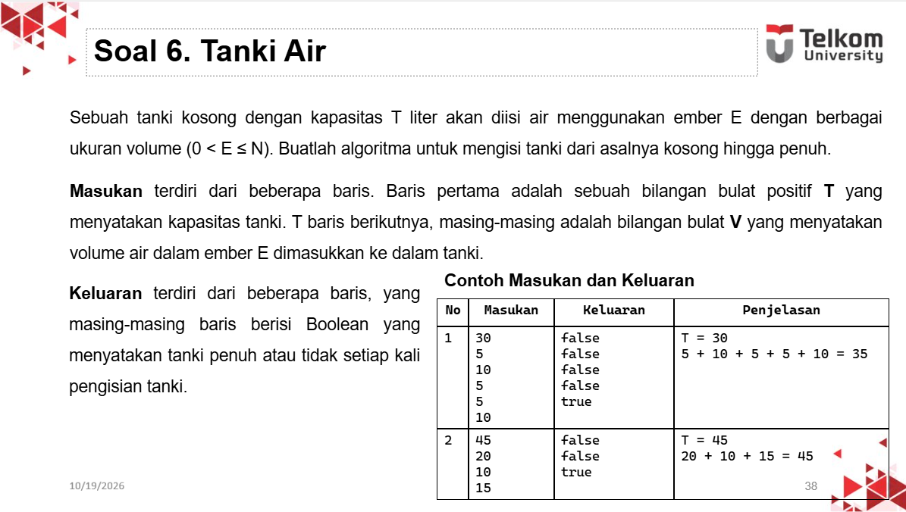
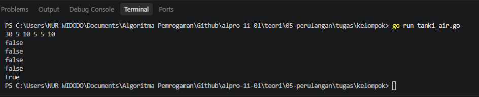

# <h1 align="center">Tugas Kelompok 05</h1>
<p align="center">Nur Widodo - 109092630005</p>

### 1. Soal Tanki Air

### Soal:


### Pseudocode:
```
algoritma KapasitasGudang
kamus
    T, V, total : integer
mulai
    input(T)
    total <- 0
    
    while total < T do
        input(V)
        total <- total + V
        
        if total >= T then
            output(true)
        else
            output(false)
        endif
    endwhile
selesai
```

### Kode Go:
```go
package main

import "fmt"

func main() {
	var T, V, total int
	fmt.Scan(&T)
	for total < T {
		fmt.Scan(&V)
		total += V
		if total >= T {
			fmt.Println(true)
		} else {
			fmt.Println(false)
		}
	}
}

```

### Output:
