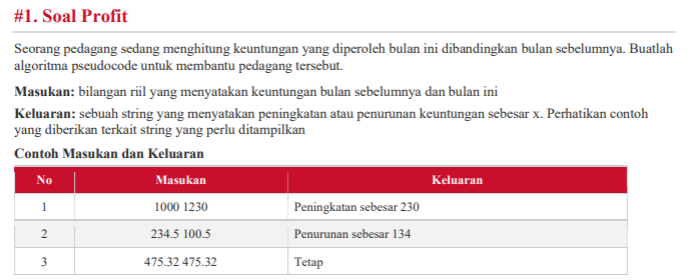
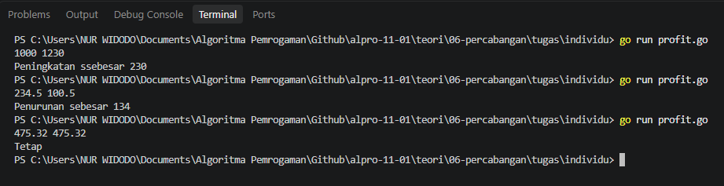
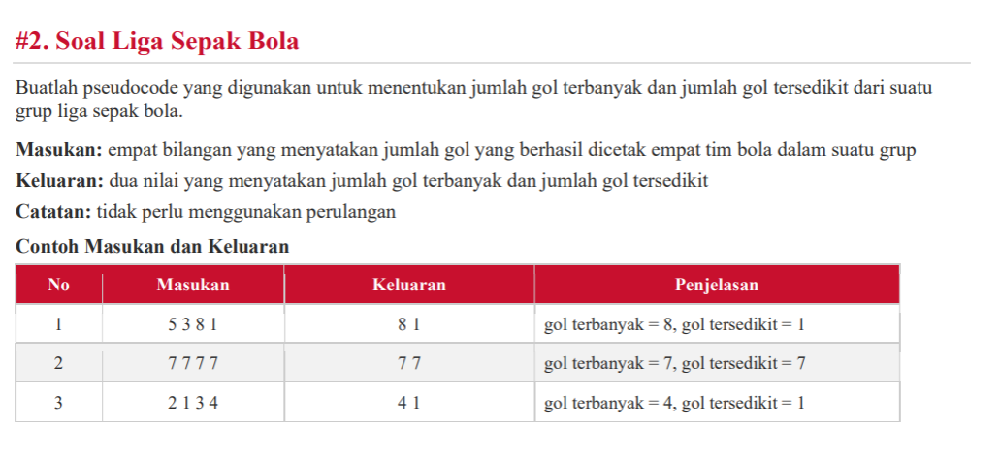
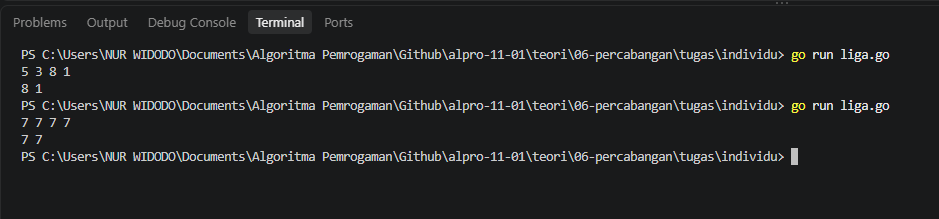
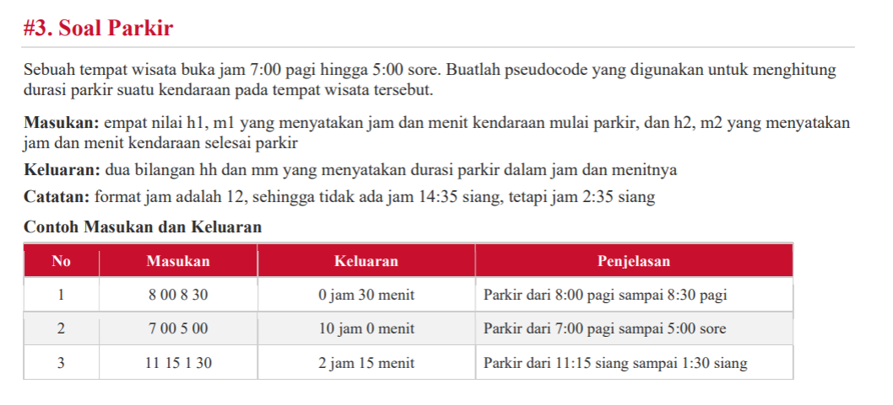
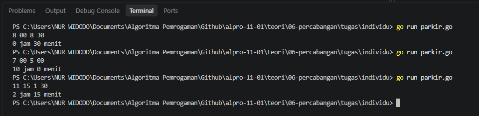
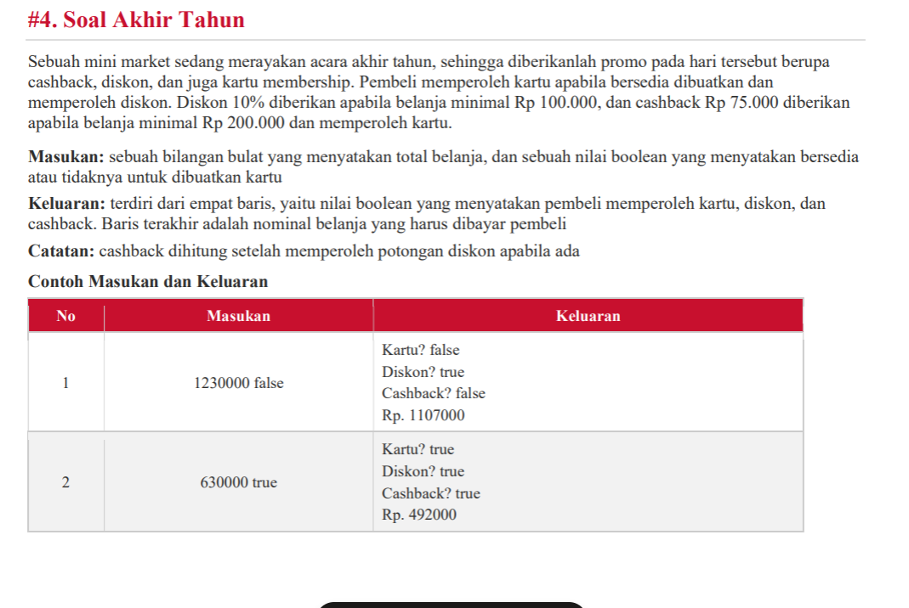
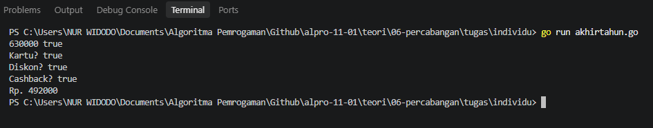
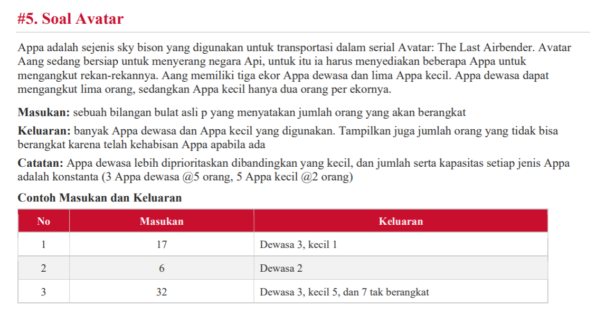
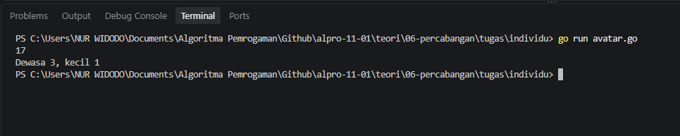

# <h1 align="center">Tugas Mandiri 06</h1>
<p align="center">Nur Widodo - 109092630005</p>

### 1. Soal Profit
### Soal:


### Kode Go:
```go
package main

import "fmt"

func main()  {
	var bulanSebelumnya, bulanIni float64

	fmt.Scan(&bulanSebelumnya, &bulanIni)

	if bulanIni > bulanSebelumnya {
		selisih := bulanIni - bulanSebelumnya
		fmt.Printf("Peningkatan ssebesar %g\n", selisih)
	} else if bulanIni < bulanSebelumnya {
		selisih := bulanSebelumnya - bulanIni
		fmt.Printf("Penurunan sebesar %g\n", selisih)
	} else {
		fmt.Println("Tetap")
	}
}
```

### Output:



### 2. Soal Liga sepak bola
### Soal:


### kode go:

```go
package main

import "fmt"

func main() {
	var a, b, c, d int

	fmt.Scan(&a, &b, &c, &d)
	maks := a
	if b > maks {
		maks = b
	}
	if c > maks {
		maks = c
	}
	if d > maks {
		maks = d
	}

	min := a
	if b < min {
		min = b
	}
	if c < min {
		min = c
	}
	if d < min {
		min = d
	}

	fmt.Printf("%d %d\n", maks, min)
}
```
### Output:


### 3. Soal Parkir
### Soal:


### Kode Go:
```go
package main

import (
	"fmt"
)

func main() {
	var h1, m1, h2, m2 int
	fmt.Scan(&h1, &m1, &h2, &m2)

	if h1 >= 1 && h1 <= 5 {
		h1 += 12
	}
	if h2 >= 1 && h2 <= 5 {
		h2 += 12
	}

	mulai := (h1-7)*60 + m1
	selesai := (h2-7)*60 + m2

	durasi := selesai - mulai
	hh := durasi / 60
	mm := durasi % 60

	fmt.Printf("%d jam %d menit\n", hh, mm)
}
```

### Output:


### 4. Soal Akhir tahun
### Soal:


### Kode Go:
```go
package main

import (
	"fmt"
)

func main() {
	var totalBelanja float64
	var bersediaKartu bool

	fmt.Scan(&totalBelanja, &bersediaKartu)

	dapatKartu := bersediaKartu
	dapatDiskon := false
	dapatCashback := false

	if totalBelanja >= 100000 && dapatKartu {
		dapatDiskon = true
		totalBelanja = totalBelanja - (0.10 * totalBelanja)
	}

	if totalBelanja >= 200000 && dapatKartu {
		dapatCashback = true
		totalBelanja = totalBelanja - 75000
	}

	fmt.Printf("Kartu? %t\n", dapatKartu)
	fmt.Printf("Diskon? %t\n", dapatDiskon)
	fmt.Printf("Cashback? %t\n", dapatCashback)
	fmt.Printf("Rp. %.0f\n", totalBelanja)
}
```

### Output:


### 5. Soal Avatar
### Soal:


### Kode Go:
```go
package main

import (
	"fmt"
)

func main() {
	var orang int
	fmt.Scan(&orang)

	dewasa := orang / 5
	if dewasa > 3 {
		dewasa = 3
	}
	orang -= dewasa * 5

	kecil := orang / 2
	if kecil > 5 {
		kecil = 5
	}
	orang -= kecil * 2

	takBerangkat := orang

	if dewasa > 0 {
		fmt.Printf("Dewasa %d", dewasa)
	}
	if kecil > 0 {
		if dewasa > 0 {
			fmt.Print(", ")
		}
		fmt.Printf("kecil %d", kecil)
	}
	if takBerangkat > 0 {
		if dewasa > 0 || kecil > 0 {
			fmt.Print(", dan ")
		}
		fmt.Printf("%d tak berangkat", takBerangkat)
	}
	fmt.Println()
}
```

### Output:
