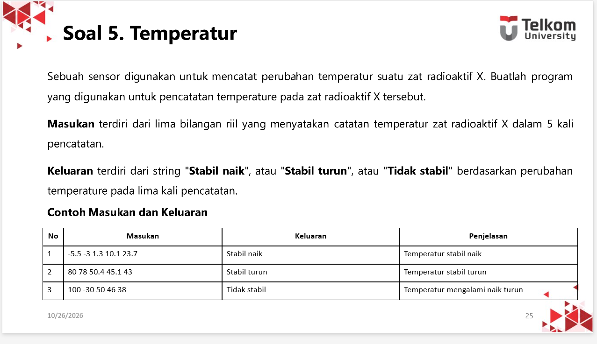
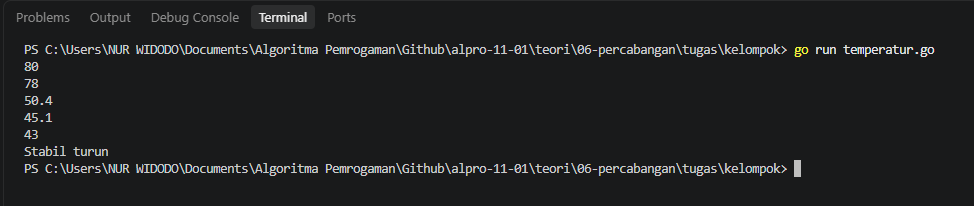

# <h1 align="center">Tugas Kelompok 06</h1>
<p align="center">Nur Widodo - 109092630005</p>

### 1. Temperatur

### Soal:


### Pseudocode:
```
program CekKestabilanSuhu
kamus
    t : array [0..4] of real
    i : integer
    naik, turun : boolean

algoritma
    // Membaca input array
    for i <- 0 to 4 do
        input(t[i])
    endfor

    // Inisialisasi status
    naik <- true
    turun <- true

    // Memeriksa pola kenaikan / penurunan
    for i <- 0 to 3 do
        if t[i+1] <= t[i] then
            naik <- false
        endif
        if t[i+1] >= t[i] then
            turun <- false
        endif
    endfor

    // Menampilkan hasil berdasarkan kondisi
    if naik then
        output("Stabil naik")
    else if turun then
        output("Stabil turun")
    else
        output("Tidak stabil")
    endif
endprogram
```

### Kode Go:
```go
package main

import (
	"fmt"
)

func main() {
	var t [5]float64

	for i := 0; i < 5; i++ {
		fmt.Scan(&t[i])
	}

	naik := true
	turun := true

	for i := 0; i < 4; i++ {
		if t[i+1] <= t[i] {
			naik = false
		}
		if t[i+1] >= t[i] {
			turun = false
		}
	}

	if naik {
		fmt.Println("Stabil naik")
	} else if turun {
		fmt.Println("Stabil turun")
	} else {
		fmt.Println("Tidak stabil")
	}
}

```

### Output:
