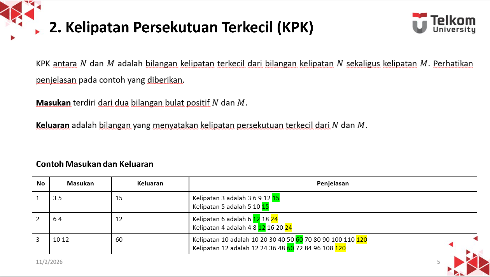
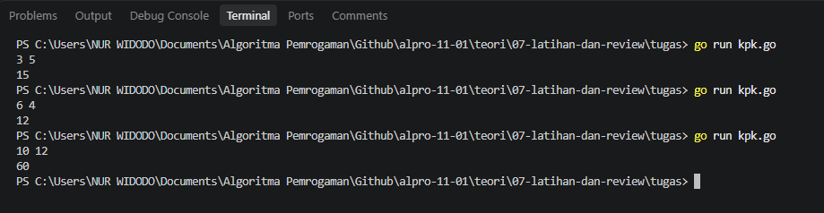

# <h1 align="center">Tugas Mandiri 07</h1>
<p align="center">Nur Widodo - 109092630005</p>

### 1. Soal Kelipatan Persekutuan Terkecil
### Soal:


### Kode Go:
```go
package main

import "fmt"

func main() {
	var n, m int
	fmt.Scan(&n, &m)

	a, b := n, m
	for b != 0 {
		a, b = b, a%b
	}

	kpk := (n * m) / a
	fmt.Println(kpk)
}
```

### Output:

