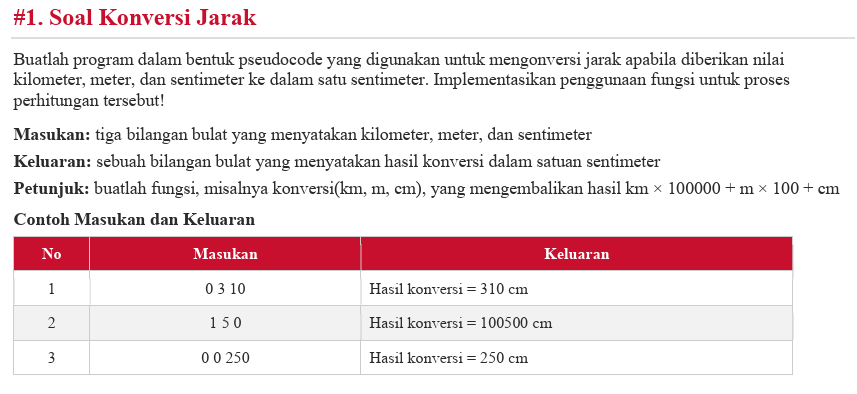
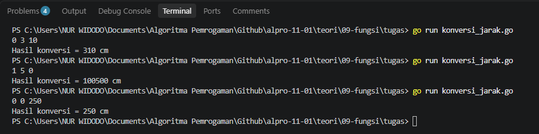
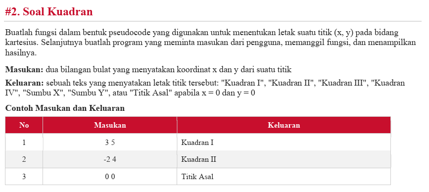
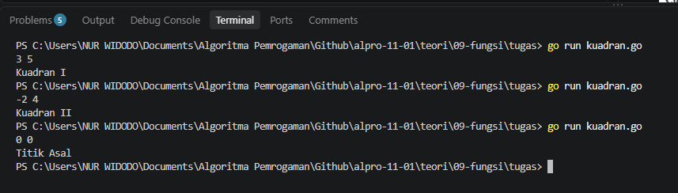
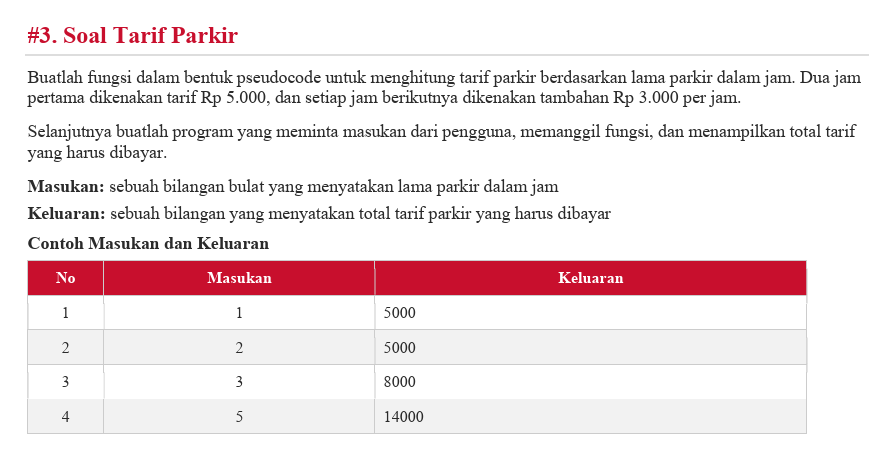
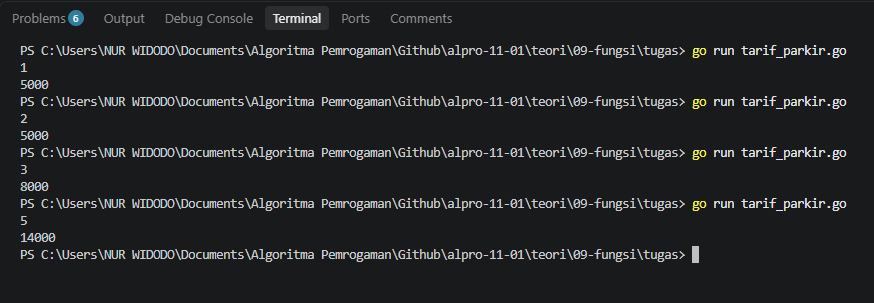
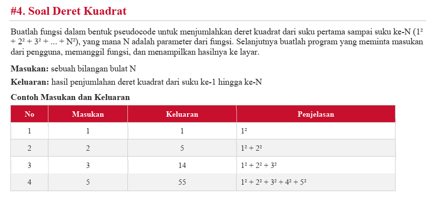
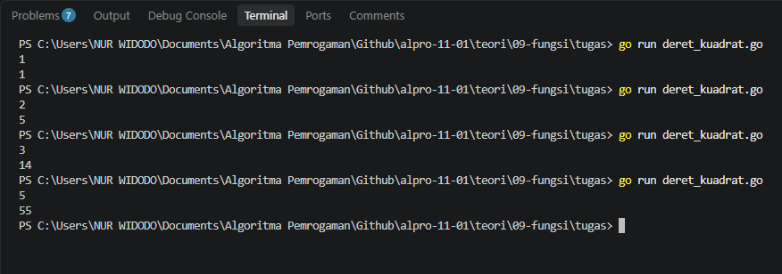
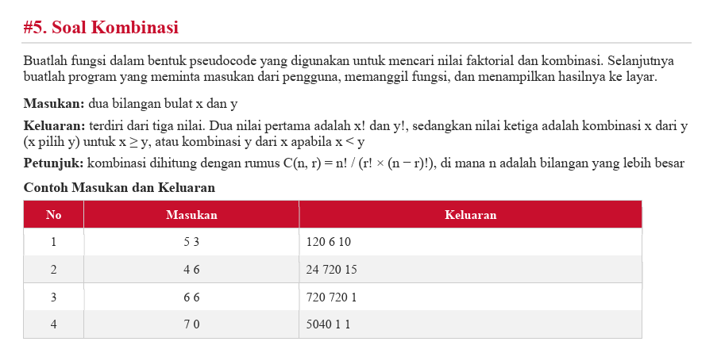
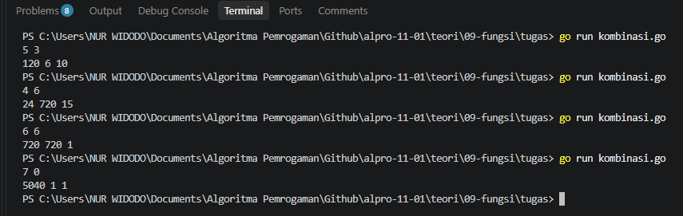

# <h1 align="center">Tugas Mandiri 09</h1>
<p align="center">Nur Widodo - 109092630005</p>

### 1. Soal Konversi Jarak
### Soal:


### Kode Go:
```go
package main

import "fmt"

func konversi(km, m, cm int) int {
	return km*100000 + m*100 + cm
}

func main() {
	var km, m, cm int
	fmt.Scan(&km, &m, &cm)
	hasil := konversi(km, m, cm)
	fmt.Printf("Hasil konversi = %d cm\n", hasil)
}

```

### Output:


### 2. Soal Kuadran
### Soal:


### Kode Go:
```go
package main

import "fmt"

func cekKuadran(x, y int) string {
	if x == 0 && y == 0 {
		return "Titik Asal"
	} else if y == 0 {
		return "Sumbu X"
	} else if x == 0 {
		return "Sumbu Y"
	} else if x > 0 && y > 0 {
		return "Kuadran I"
	} else if x < 0 && y > 0 {
		return "Kuadran II"
	} else if x < 0 && y < 0 {
		return "Kuadran III"
	} else {
		return "Kuadran IV"
	}
}

func main() {
	var x, y int
	fmt.Scan(&x, &y)
	fmt.Println(cekKuadran(x, y))
}

```

### Output:


### 3. Soal Tarif Parkir
### Soal:


### Kode Go:
```go
package main

import "fmt"

func hitungParkir(jam int) int {
	if jam <= 2 {
		return 5000
	}
	return 5000 + (jam-2)*3000
}

func main() {
	var jam int
	fmt.Scan(&jam)
	fmt.Println(hitungParkir(jam))
}
```

### Output:


### 4. Soal Deret Kuadrat
### Soal:


### Kode Go:
```go
package main

import "fmt"

func deretKuadrat(n int) int {
	total := 0
	for i := 1; i <= n; i++ {
		total += i * i
	}
	return total
}

func main() {
	var n int
	fmt.Scan(&n)
	fmt.Println(deretKuadrat(n))
}
```

### Output:


### 5. Soal Kombinasi
### Soal:


### Kode Go:
```go
package main

import "fmt"

func faktorial(n int) int {
	if n == 0 {
		return 1
	}
	hasil := 1
	for i := 1; i <= n; i++ {
		hasil *= i
	}
	return hasil
}

func main() {
	var x, y int
	fmt.Scan(&x, &y)

	fakX := faktorial(x)
	fakY := faktorial(y)

	n, r := x, y
	if x < y {
		n = y
		r = x
	}

	kom := faktorial(n) / (faktorial(r) * faktorial(n-r))
	fmt.Println(fakX, fakY, kom)
}
```

### Output:

